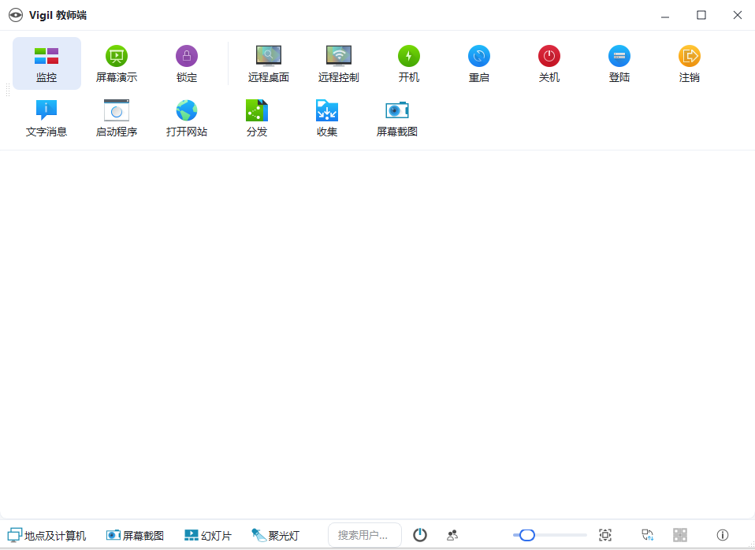
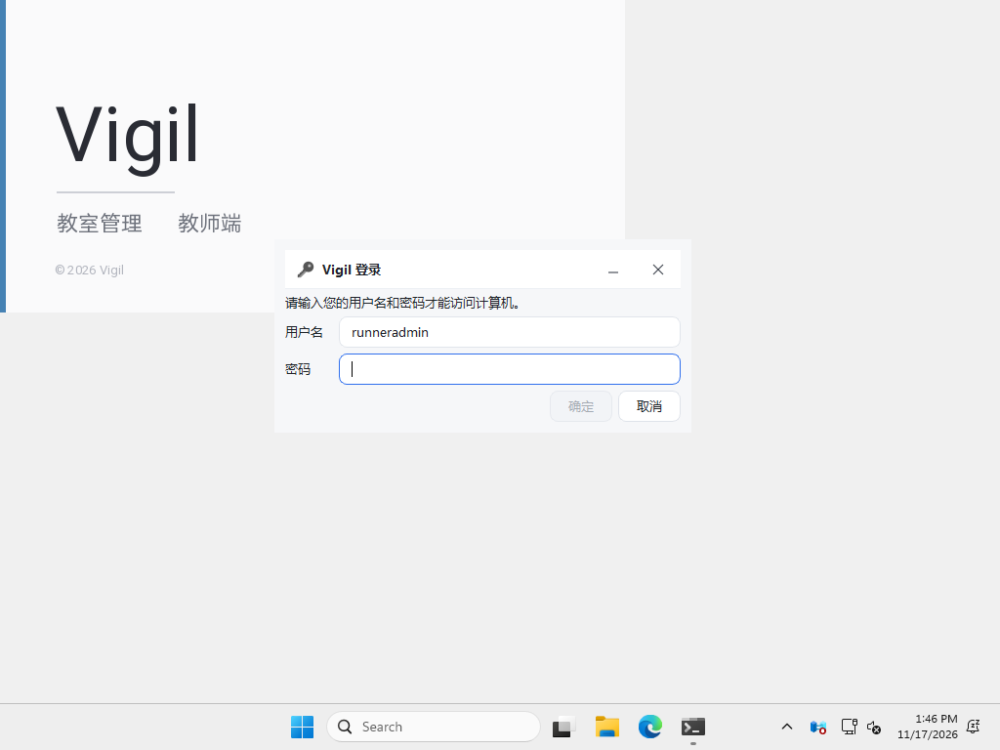
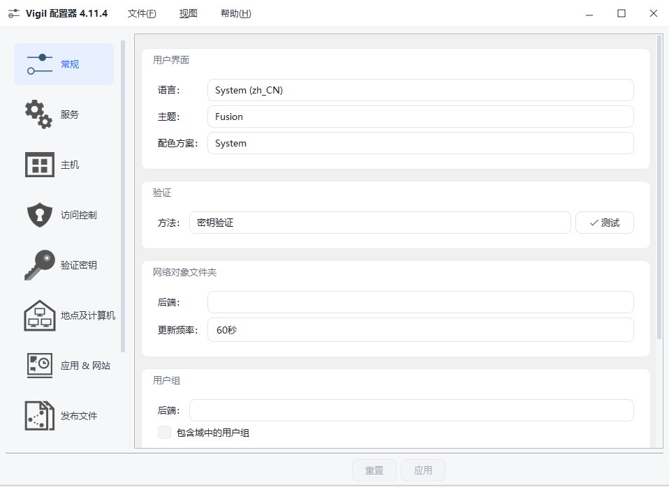
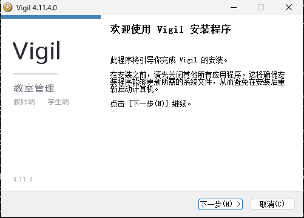

<div align="center">

# Vigil

**重做的机房课堂管理工具**

一个教师窗口，实时管控整间机房。监控、广播、锁屏、发消息、发文件、开关机，全在局域网内完成。

<a href="#english"></a>
&nbsp;&nbsp;
<a href="#简体中文"></a>

[](#安装)
[](#从源码构建)
[](COPYING)
[](#架构)

</div>

---

<a id="简体中文"></a>

## 这是什么

Vigil 是一套免费的机房与数字教室管理软件。教师的机器上开一个窗口，就能实时看住、管住一整个教室的学生机。不联云、不订阅、不联网，数据全部留在你自己的局域网里。

它是为这种场景写的：一个老师、四十台电脑、四十五分钟一节课，还要把时间花在讲课上，而不是排障上。

## 功能

| | 功能 | 说明 |
|---|---|---|
| 👁 | **监控** | 所有电脑的画面缩略图铺在一个网格里，实时刷新 |
| 🖥 | **远程访问** | 查看或直接接管任意学生的屏幕，支持剪贴板互通 |
| 📺 | **屏幕广播** | 把你的屏幕实时推给全班，支持全屏或窗口模式 |
| 🔒 | **锁屏** | 一键锁住所有屏幕，并显示你自定义的提示文字 |
| 💬 | **消息** | 向指定机器推送一条文字消息 |
| 🎬 | **上下课** | 一次操作让全班集体登录或注销 |
| 📸 | **截图存档** | 抓取学生屏幕并存进管理面板，可回看、可归档 |
| 🚀 | **远程启动** | 在所有机器上启动程序或打开指定网址 |
| 📁 | **文件分发** | 把课件、文档一键推送到整个教室 |
| ⚡ | **开关机** | 远程关机、重启，支持 Wake-on-LAN 网络唤醒 |
| 🎞 | **幻灯片** | 自动轮播学生屏幕，适合逐个点评 |
| 🔦 | **聚光灯** | 放大显示选定的一批机器，其余变暗 |
| 🗂 | **机房目录** | 从 CSV 批量导入机位，或从 LDAP 拉取用户组 |
| 🔌 | **Web API** | 通过 HTTP 调用任意功能，方便接自建系统 |
| 🛡 | **防删保护** | 程序文件加 Deny Delete 权限，本地管理员没有口令也删不掉 |

## 安装

### Windows（64 位）

到 [Releases](../../releases) 页面下载安装包，教师机装 **`vigil-teacher-4.11.4.0-win64-setup.exe`**，学生机装 **`vigil-student-4.11.4.0-win64-setup.exe`**，双击安装。

安装程序会做这几件事：

1. 安装主控端、后台服务、执行器与配置工具
2. 注册并启动 `Vigil` 系统服务（启动类型固定为**自动**，随系统开机自启）
3. 为服务端口添加 Windows 防火墙例外
4. 创建开始菜单与桌面快捷方式

**系统要求**：Windows 10 / 11 / Server 2019 及以上，64 位。

> 服务以 `LocalSystem` 身份运行，才能管理用户会话与电源状态。
> 第一次进机房前，先用 **Vigil Configurator** 配好网络与认证。

#### 防删保护

教师端下发“课堂口令”后，学生机会自动加固：

- 程序目录加入 `Deny Delete` 权限，**本地管理员也删不掉** `C:\Program Files\Vigil` 里的任何文件
- 系统服务移除 `SERVICE_STOP` / `SERVICE_CHANGE_CONFIG`，`net stop`、服务管理器、任务管理器都停不掉
- 服务被强杀后由 SCM 一秒内拉起，另有隐藏的 SYSTEM 计划任务每 2 分钟补位
- 服务启动类型固定为 `Automatic`，重启后自动恢复

卸载或覆盖安装需要先解除保护：卸载程序会弹出口令输入框，静默卸载传 `/Unlock=<口令>`。

```cmd
uninstall.exe /S /Unlock=1234
```

口令错误会直接取消操作。需要说明的是，取得所有权后改写 DACL 仍可绕过——本方案的目标是“随手关不掉”，不是内核级 PPL 防护。

### 卸载

控制面板 → *程序和功能* → **Vigil**。服务会自动停止并注销。

若已启用防删保护，卸载向导会先要求输入教师口令；口令正确才继续删除文件。

## 从源码构建

### Linux（Ubuntu 22.04+ / Debian 12+）

```bash
sudo apt install -y build-essential cmake ninja-build git \
  qt6-base-dev qt6-tools-dev qt6-l10n-tools \
  libqca-qt6-dev libvncserver-dev libssl-dev \
  zlib1g-dev libpng-dev libjpeg-dev liblzo2-dev

git clone https://github.com/CheapJBH/Vigil.git && cd Vigil
cmake -S . -B build -G Ninja -DCMAKE_BUILD_TYPE=Release -DWITH_QT6=ON
cmake --build build -j"$(nproc)"
sudo cmake --install build
```

### Windows（MSVC）

```powershell
# 前置：Visual Studio 2022、Qt 6（msvc2022_64）、OpenSSL、QCA、NSIS
cmake -S . -B build -G "Visual Studio 17 2022" -A x64 `
  -DCMAKE_PREFIX_PATH="C:\Qt\6.7.0\msvc2022_64" -DWITH_QT6=ON
cmake --build build --config Release -j
cd build && cpack -G NSIS64
```

安装包会生成在 `build/_CPack_Packages/win64/NSIS/`。

## 架构

Vigil 由五个协同工作的可执行程序加一层插件组成：

```
┌──────────────┐   功能指令（TCP 11100，RFB 变体）        ┌──────────────┐
│ vigil-master │ ──────────────────────────────────────▶ │ vigil-server │
│   教师界面    │ ◀────────────────── 画面流 ─────────── │   无界面服务  │
└──────────────┘                                         └──────┬───────┘
                                                                │ 拉起
                                                         ┌──────▼───────┐
                                                         │ vigil-worker │
                                                         │ 每个任务一个  │
                                                         └──────────────┘
```

| 组件 | 职责 |
|---|---|
| `core/` | 功能与插件框架、RFB 协议栈、认证、配置、日志 |
| `master/` | 教师端界面：监控网格、侧边面板、工具栏 |
| `server/` | 学生端无界面服务，监听 11100 端口 |
| `service/` | 系统服务外壳（systemd / Windows 服务） |
| `worker/` | 每次执行功能时临时拉起的短命进程 |
| `cli/` | `vigil-cli` 与 `vigil-wcli`，纯命令行管理 |
| `configurator/` | 图形化配置工具 |
| `plugins/` | 17 个功能插件（广播、文件传输、电源控制等） |

**一切皆功能（Feature）。** 每个能力都声明自己的 UID、显示名、图标、快捷键，以及允许运行在哪些组件上（`Master` / `Service` / `Worker`）。`FeatureManager` 负责把教师端的调用路由到学生机上正确的进程。要加功能，写插件就行，不用动内核。

**传输层**：自研 RFB（VNC）变体，支持三种认证方式——RSA 密钥对、系统账号密码、预共享令牌，加密走 QCA + OpenSSL。

## 配置

| 平台 | 存储位置 |
|---|---|
| Windows | 注册表 `HKLM\SOFTWARE\Vigil`（系统级）、`HKCU\SOFTWARE\Vigil`（用户级） |
| Linux | `/etc/vigil/`（系统级）、`~/.config/Vigil/`（用户级） |

```bash
# 非交互式管理
vigil-cli config list
vigil-cli config set Network/VigilServerPort 11100
vigil-cli config export > room.ini
vigil-cli config import room.ini

# 服务控制（Windows）
vigil-wcli service register
vigil-wcli service start
```

机房列表可以从 CSV 导入：

```csv
# computers.csv —— 每行一台机器
PC-01,192.168.1.11
PC-02,192.168.1.12
```

## 界面

### 界面预览

| 教师端主界面 | 登录框 |
|:---:|:---:|
|  |  |

| 配置器 | 安装向导 |
|:---:|:---:|
|  |  |


- Qt Widgets 实现，不背 QML 运行时的包袱
- 缩略图网格由自定义 item delegate 绘制：圆角边框、状态描边、功能角标
- 五个侧边面板：**选择**、**截图**、**幻灯片**、**聚光灯**、**关于**
- 工具栏支持网格缩放、自动适配、手动排位、仅显示开机、实时名称过滤

## 参与贡献

欢迎提 Issue 和 Pull Request。请沿用现有代码风格（Tab 缩进、Qt 命名习惯、`v` 前缀日志函数），并在 Qt 6 构建下自测。

## 许可证

Vigil 是自由软件，以 **GNU 通用公共许可证 v2.0** 发布。
完整文本见 [COPYING](COPYING)。

<div align="center">
<sub>写给那些宁愿把时间花在讲课上、而不是排障上的老师。</sub>
</div>

---

<br>

<a id="english"></a>

<div align="center">

# Vigil

**Classroom monitoring & control, reimagined.**

Monitor every screen in the room. Share yours. Lock, message, launch, distribute, power off — from one window.

<a href="#简体中文"></a>
&nbsp;&nbsp;
<a href="#english"></a>

</div>

---

## What is Vigil?

Vigil is a free, open-source classroom management suite for computer labs and digital classrooms.
One teacher window controls an entire room of machines in real time — no cloud account, no
subscription, no data leaving your network.

Built for the case where a teacher has 40 students, 40 PCs, and 45 minutes.

## Features

| | Feature | What it does |
|---|---|---|
| 👁 | **Monitor** | Live thumbnails of every machine in one grid, auto-refreshing |
| 🖥 | **Remote access** | View or take control of any student screen, with clipboard sync |
| 📺 | **Demo** | Broadcast your screen fullscreen or in a window, real time |
| 🔒 | **Screen lock** | Freeze all screens with a custom message |
| 💬 | **Message** | Push a text message to selected machines |
| 🎬 | **Lesson control** | Log students in / out across the room in one action |
| 📸 | **Screenshots** | Capture and archive student screens into a review panel |
| 🚀 | **Launch** | Start a program or open a URL on every machine |
| 📁 | **Distribute** | Push files and documents to the room |
| ⚡ | **Power** | Shut down, reboot, or Wake-on-LAN selected machines |
| 🎞 | **Slideshow** | Auto-cycle student screens for review |
| 🔦 | **Spotlight** | Zoom into a chosen subset and dim the rest |
| 🗂 | **Directory** | Import rooms from CSV, or pull groups from LDAP |
| 🔌 | **Web API** | Drive any feature over HTTP for custom integrations |
| 🛡 | **Anti-delete** | Program files get a Deny Delete ACE — even local admins can't remove them without the code |

## Installation

### Windows (64-bit)

Download the installer from the [Releases](../../releases) page — **`vigil-teacher-4.11.4.0-win64-setup.exe`**
for the teacher machine, **`vigil-student-4.11.4.0-win64-setup.exe`** for student machines.

The installer:

1. Installs the master application, service, worker, and configurator
2. Registers and starts the `Vigil` background service (start type **Automatic**, runs at boot)
3. Adds a Windows Firewall exception for the service port
4. Creates Start Menu and desktop shortcuts

**Requirements:** Windows 10 / 11 / Server 2019+, 64-bit.

> The service runs as `LocalSystem` so it can manage sessions and power state.
> Configure it via **Vigil Configurator** before first classroom use.

#### Anti-delete protection

Once the teacher pushes a classroom code, student machines harden themselves automatically:

- A `Deny Delete` ACE is added to the install directory, so **even a local administrator cannot
  delete anything** under `C:\Program Files\Vigil`
- The service drops `SERVICE_STOP` / `SERVICE_CHANGE_CONFIG` — `net stop`, the Services console,
  and Task Manager all fail to stop it
- SCM restarts the service within a second if it is killed, plus a hidden SYSTEM scheduled task
  re-arms it every two minutes
- Start type is pinned to `Automatic`, so it comes back after a reboot

Uninstalling or reinstalling requires unlocking first: the uninstaller prompts for the teacher
code, and silent uninstalls take `/Unlock=<code>`.

```cmd
uninstall.exe /S /Unlock=1234
```

A wrong code aborts the operation. Taking ownership and rewriting the DACL still bypasses this —
the goal is "not casually removable", not kernel-level PPL protection.

### Uninstall

Control Panel → *Programs and Features* → **Vigil**. The service is stopped and unregistered
automatically.

If anti-delete protection is active, the uninstall wizard asks for the teacher code before
removing any file.

## Build from source

### Linux (Ubuntu 22.04+ / Debian 12+)

```bash
sudo apt install -y build-essential cmake ninja-build git \
  qt6-base-dev qt6-tools-dev qt6-l10n-tools \
  libqca-qt6-dev libvncserver-dev libssl-dev \
  zlib1g-dev libpng-dev libjpeg-dev liblzo2-dev

git clone https://github.com/CheapJBH/Vigil.git && cd Vigil
cmake -S . -B build -G Ninja -DCMAKE_BUILD_TYPE=Release -DWITH_QT6=ON
cmake --build build -j"$(nproc)"
sudo cmake --install build
```

### Windows (MSVC)

```powershell
# Prerequisites: Visual Studio 2022, Qt 6 (msvc2022_64), OpenSSL, QCA, NSIS
cmake -S . -B build -G "Visual Studio 17 2022" -A x64 `
  -DCMAKE_PREFIX_PATH="C:\Qt\6.7.0\msvc2022_64" -DWITH_QT6=ON
cmake --build build --config Release -j
cd build && cpack -G NSIS64
```

The installer lands in `build/_CPack_Packages/win64/NSIS/`.

## Architecture

Vigil is split into five cooperating binaries plus a plugin layer:

```
┌──────────────┐   FeatureMessage (TCP 11100, RFB-based)   ┌──────────────┐
│ vigil-master │ ─────────────────────────────────────────▶ │ vigil-server │
│  teacher UI  │ ◀────────────────── frames ────────────── │  headless    │
└──────────────┘                                            └──────┬───────┘
                                                                   │ spawns
                                                            ┌──────▼───────┐
                                                            │ vigil-worker │
                                                            │ one per task │
                                                            └──────────────┘
```

| Component | Role |
|---|---|
| `core/` | Feature & plugin framework, RFB protocol stack, auth, config, logging |
| `master/` | Teacher GUI — monitoring grid, panels, toolbar |
| `server/` | Headless per-machine service listening on port 11100 |
| `service/` | OS service wrapper (systemd / Windows service) |
| `worker/` | Short-lived process spun up per feature execution |
| `cli/` | `vigil-cli` and `vigil-wcli` for headless administration |
| `configurator/` | Graphical configuration tool |
| `plugins/` | 17 feature modules (demo, file transfer, power control, …) |

**Everything is a Feature.** Each capability declares a UID, display name, icon, shortcut, and
a set of component flags (`Master` / `Service` / `Worker`). The `FeatureManager` routes
invocations from the teacher to the right process on the student machine. Adding a capability
means adding a plugin — not touching the core.

**Transport:** custom RFB (VNC) dialect with three authentication modes — RSA key pair,
system logon credentials, or pre-shared token — encrypted via QCA + OpenSSL.

## Configuration

| Platform | Storage |
|---|---|
| Windows | Registry — `HKLM\SOFTWARE\Vigil` (system), `HKCU\SOFTWARE\Vigil` (user) |
| Linux | `/etc/vigil/` (system), `~/.config/Vigil/` (user) |

```bash
# Non-interactive administration
vigil-cli config list
vigil-cli config set Network/VigilServerPort 11100
vigil-cli config export > room.ini
vigil-cli config import room.ini

# Service control (Windows)
vigil-wcli service register
vigil-wcli service start
```

Room lists can be imported from CSV:

```csv
# computers.csv — one machine per line
PC-01,192.168.1.11
PC-02,192.168.1.12
```

## UI notes

### Screenshots

| Teacher console | Logon dialog |
|:---:|:---:|
|  |  |

| Configurator | Installer |
|:---:|:---:|
|  |  |


- Qt Widgets, no QML runtime overhead
- Thumbnail grid redrawn by a custom item delegate (rounded frame, status ring, feature badges)
- Five side panels: **Select**, **Screenshots**, **Slideshow**, **Spotlight**, **About**
- Grid size slider, auto-fit, manual positioning, power-on filter, live name filter

## Contributing

Issues and pull requests are welcome. Please keep the existing code style (tabs, Qt naming,
`v`-prefixed logging helpers) and test on both Qt 6 builds.

## License

Vigil is free software, released under the **GNU General Public License v2.0**.
See [COPYING](COPYING) for the full text.

<div align="center">
<sub>Built for teachers who would rather teach than troubleshoot.</sub>
</div>
